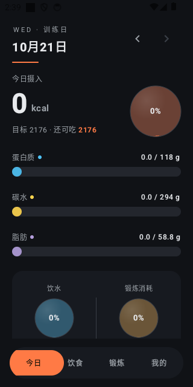
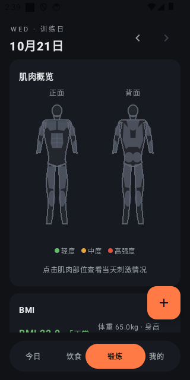

# 增肌日记 · Muscle Diary

<p align="center">
  <strong>不用联网的增肌/减脂训练与饮食记录 App</strong><br>
  纯本地 · 无账号 · 零上传 · 公式全透明 · 1.4 MB
</p>

<p align="center">
  <a href="README_EN.md">English</a> · <strong>中文</strong> ·
  <a href="https://mengpolar.github.io/musclediary/">项目主页</a> ·
  <a href="https://github.com/Mengpolar/musclediary/releases/latest">下载最新 APK</a>
</p>

<p align="center">
  <a href="https://github.com/Mengpolar/musclediary/releases/latest"></a>
  
  
  
  
</p>

---

一款为增肌 / 减脂人群设计的**纯本地离线** Android 应用：记录每日饮食、锻炼（支持组数 × 次数/里程/秒）、饮水量与体重，按身体数据自动推导热量与三大营养素目标，并用正背面人体肌肉图直观展示当天各肌群的刺激程度。

> **服务器宕机？不存在的，我们根本没有服务器。**
> 所有数据只存在你的手机里——不需要注册账号，没有云同步，没有广告与遥测，飞行模式下照常记满今天的三组卧推。唯一的网络请求发生在你主动点击「检查更新」时。

## 界面预览

<p align="center">
  
  &nbsp;&nbsp;&nbsp;&nbsp;
  
</p>

## 核心亮点

| 维度 | 说明 |
| :--- | :--- |
| **100% 离线本地** | Room 本地数据库存储，关闭系统自动备份（`allowBackup=false`），数据从不离开设备 |
| **186 种中式食物模板** | 鸡胸肉、兰州拉面、煎饼果子、卤牛肉……贴合日常中餐；支持量词换算（如 `1个鸡蛋=50g`、`1盒牛奶=250ml`）与包装千焦（kJ）一键反推 |
| **58 种动作 + 组数录入** | 支持**单组数量 × 组数**（1~5 组快捷点选或任意组数）、按次 / 按公里 / 按秒三种模式与哑铃配重，自动换算总消耗与肌群刺激分 |
| **13 肌群人体着色图** | 正背面手绘矢量解剖人体，按当日刺激分四档着色（灰 → 绿 → 橙 → 红）+ 强度光晕，点选任意部位查看明细 |
| **目标公式完全透明** | 点击 App 内任意目标数值，立即展开带真实身体数据的完整公式推导，拒绝黑箱计算 |
| **中 / 英双语实时切换** | 应用内一键切换 `中文 / English`，内置食物、动作模板与量词单位全量双语 |

## 功能一览

### 1. 日常记录
- **饮食记录**
  - 内置 **186 种**食物模板（每 100g 蛋白质 / 碳水 / 脂肪），支持按标签筛选（高蛋白、优质碳水、健康脂肪、果蔬纤维等）
  - **量词单位换算**：按「个 / 碗 / 盒 / 片」或克数录入自动换算营养
  - **快速记录一餐**：外食或食堂不便拆分食材时，按早/午/晚/加餐直接录入整餐热量或三维营养素
  - **最近记录芯片**：输入框下方自动展示该食物最近 3 次录入克数（去重），一键即填
- **锻炼记录**
  - 内置 **58 种**动作模板，覆盖按次（REPS）、按公里（DISTANCE）、按秒（SECONDS）三类
  - **组数输入**：录入每组数量与组数（提供 `1~5 组` 快捷标签及自定义组数，如 `3组×12个`），自动汇总当次总数量计算时长、MET 热量消耗（$\text{MET} \times \text{体重} \times \text{时长}$）与肌群刺激分；支持左滑同时修改单组数量与组数
  - **哑铃配重**：哑铃类动作可附加单只重量（kg），刺激分随负重加成
  - **最近记录芯片**：保留最近 3 次「组数 × 单组数量 × 配重」组合，点击直接回填
- **饮水记录**：按次记录每日饮水，目标 $= \text{体重} \times 35\text{ ml}$，液态玻璃球动效展示进度，支持最近值快捷录入与逐条修改/删除
- **体重 / BMI**：每日体重趋势折线、与上次及上月均值环比对比、中国标准 BMI 分区条
- **月历视图**：月历标记每日热量与锻炼达标情况，点击切换任意历史日期补记或回看

### 2. 目标计算与透明推导
- **增肌 / 减脂双模式**：增肌期默认热量盈余 `+200 ~ +300 kcal`，减脂期默认热量赤字 `-300 ~ -500 kcal`
- **公式全透明**（点击 App 内任意目标数值即可查看推导过程）：
  - **基础代谢 BMR**（Mifflin-St Jeor）：
    $$\text{男}: 10W + 6.25H - 5A + 5 \qquad \text{女}: 10W + 6.25H - 5A - 161$$
  - **动态活动系数**：$1.2 + \min(0.4,\ \text{当日运动消耗} \div \text{BMR})$（上限 $1.6$）——当天练得越多，热量与碳水目标自动上调
  - **三维基础目标（每公斤体重）**：
    - 增肌期：蛋白质 $2.0\text{ g/kg}$ · 碳水 $5.0\text{ g/kg}$ · 脂肪 $1.0\text{ g/kg}$
    - 减脂期：蛋白质 $1.5\text{ g/kg}$ · 碳水 $2.0\text{ g/kg}$ · 脂肪 $0.8\text{ g/kg}$
  - **热量等比分摊**：总热量目标与三维基础热量之差按能量比例等比缩放，营养进度条同时展示「目标所需」与「热量所需」双刻度（达标标绿、超标标红）

### 3. 人体肌肉概览图
- 正面 + 背面双视图手绘矢量人体（图形数据源自 [GymMane](https://github.com/InlitX/GymMane)，GPL-3.0）
- **13 个肌群**独立计算刺激分：主练肌群 $\times 1.0$、兼练肌群 $\times 0.4$，哑铃负重按 $(1 + \text{kg}/20)$ 放大
- 四档强度着色：`灰色（未练）→ 绿色（轻度 <20）→ 橙色（中度 20~50）→ 红色（高强度 ≥50）`，点击任一肌群查看刺激分与强度档位

### 4. 数据管理与体验细节
- **模板管理**：内置与自定义模板统一检索、筛选、编辑、一键清空与补回内置；**手动修改过的内置模板在版本升级重播种时自动保留**，不会被官方数据覆盖
- **CSV 备份导出 / 导入**：纯文本 CSV 备份（含公式注入防护），可自由迁移到新手机；导入前弹窗二次确认，防止误触覆盖现有记录
- **分时段喝水提醒**：11:00 / 15:00 / 19:00 / 22:00 检查当日饮水进度，落后时发送本地通知（拒绝通知权限则自动关闭，不打扰）
- **应用内更新**：检查 GitHub Releases 最新版本，展示安装包大小与下载进度，**安装前强制校验 SHA-256 摘要**；支持 **GitHub 官方直连** 与 **[gh-proxy.com](https://gh-proxy.com) 代理加速**双更新源切换
- **精致微交互**：暗色主题、等宽数字字体（Tabular Figures）、卡片堆叠滚动、左滑编辑/删除（删除时卡片粒子化灰飞烟灭 + Snackbar 一键撤销）

## 下载与安装

1. **直接下载**：前往 [GitHub Releases](https://github.com/Mengpolar/musclediary/releases/latest) 或 [项目发布页](https://mengpolar.github.io/musclediary/) 下载最新 `musclediary-v*.apk`（约 1.4 MB，支持 Android 8.0 / API 26 及以上）
2. **应用内升级**：已安装用户可在 `我的 → 检查更新` 中直接检测并下载升级（国内网络可切换 `gh-proxy.com` 加速源）

## 隐私与安全承诺

- **零账号、零上传**：无注册登录、无远端服务器、无统计 SDK、无广告
- **最小权限**：仅包含 `INTERNET`（仅在手动点击「检查更新」时请求 GitHub）与 `POST_NOTIFICATIONS`（仅用于本地喝水提醒，可拒绝）
- **私有沙盒**：数据库存放在应用私有目录，且显式关闭 `android:allowBackup="false"`，系统云备份或换机助手不会在后台读取或上传你的记录
- **安装包校验**：应用内更新下载完成后，使用 GitHub Release Asset 返回的官方 SHA-256 摘要校验文件完整性，校验通过才调起系统安装器

## 本地构建

环境要求：**JDK 17**、**Android SDK (compileSdk 34)**。

```bash
# 运行全部单元测试（计算引擎 / CSV 编解码 / 模板数据源 / 更新器）
./gradlew test

# 构建 Debug 安装包（输出至 app/build/outputs/apk/debug/）
./gradlew assembleDebug
```

如需构建签名版 Release APK，请在项目根目录创建 `keystore.properties`（已被 `.gitignore` 忽略，切勿提交）：

```properties
storeFile=/path/to/release.jks
storePassword=your_store_password
keyAlias=your_key_alias
keyPassword=your_key_password
```

然后执行：

```bash
./gradlew assembleRelease
```

## 技术栈

- **语言与 UI**：Kotlin 2.0 + Jetpack Compose (Material 3) + Canvas 自定义绘制（矢量人体图、液态玻璃球、粒子粉碎动效）
- **数据层**：Room 本地数据库（含完整 Schema 导出与 1→11 平滑迁移链）+ 纯函数 CSV 备份编解码器
- **架构**：单 Activity + Compose 声明式状态 + ViewModel 协程单向数据流，无第三方重型框架依赖

## 开源许可

本项目基于 [MIT License](LICENSE) 开源 © Mengpolar。人体肌肉矢量轮廓数据来自 [GymMane](https://github.com/InlitX/GymMane)（GPL-3.0）。
