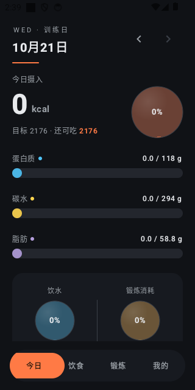
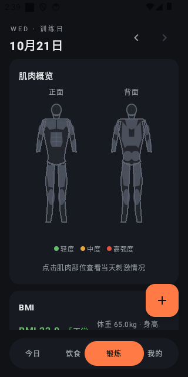

# Muscle Diary (增肌日记)

<p align="center">
  <strong>An offline-first Android workout & nutrition tracker for bulking and cutting</strong><br>
  100% Local · No Account · Zero Uploads · Transparent Math · ~1.4 MB
</p>

<p align="center">
  <strong>English</strong> · <a href="README.md">中文</a> ·
  <a href="https://mengpolar.github.io/musclediary/">Project Homepage</a> ·
  <a href="https://github.com/Mengpolar/musclediary/releases/latest">Download Latest APK</a>
</p>

<p align="center">
  <a href="https://github.com/Mengpolar/musclediary/releases/latest"></a>
  
  
  
  
</p>

---

**Muscle Diary** is a **fully offline** Android app built for bulking and cutting: log daily meals, workouts (with **sets × reps / km / seconds**), water intake, and body weight; automatically derive daily calorie and macro targets from your body stats; and visualize muscle stimulation on a front-and-back anatomy body map.

> **Server down? Impossible — there is no server.**
> Every record lives on your phone. No sign-up, no cloud sync, no ads, no analytics. Log your three sets of bench press in airplane mode. The only network request ever made is when you manually tap "Check for updates".

## Screenshots

<p align="center">
  
  &nbsp;&nbsp;&nbsp;&nbsp;
  
</p>

## Highlights

| Feature | What it means |
| :--- | :--- |
| **100% Local & Offline** | Stored in a local Room database with `allowBackup="false"` — your data never leaves your device |
| **186 Built-in Food Templates** | Bilingual templates (per 100g protein/carbs/fat), unit conversions (`1 egg = 50g`, `1 carton = 250ml`), and instant kJ-to-macro estimation |
| **58 Exercises + Set Logging** | Log **per-set quantity × sets** (1–5 quick-pick chips or any set count) by reps, km, or seconds, plus optional dumbbell weight; auto-calculates calories & muscle stimulation |
| **13-Group Muscle Body Map** | Front & back vector anatomy figures colored across 4 stimulation tiers (Gray → Green → Orange → Red) with intensity glow; tap any muscle to inspect |
| **Transparent Math** | Tap any target number in the app to see the exact step-by-step formula populated with your own stats |
| **Instant Bilingual Switch** | Switch between `中文 / English` inside the app without changing system language; all built-in templates and units are bilingual |

## Features in Detail

### 1. Fast Daily Logging
- **Food & Nutrition**
  - **186 built-in food templates** with tag filtering (High Protein, Quality Carbs, Healthy Fats, Fiber, etc.)
  - **Unit-based logging**: enter by piece / bowl / carton or grams with automatic conversion
  - **Quick meal entry**: log a whole meal (Breakfast / Lunch / Dinner / Snack) by calories or macros when eating out
  - **One-tap recent chips**: your last 3 distinct quantities for each food are shown as quick chips
- **Workouts**
  - **58 built-in movement templates** across Reps (`REPS`), Distance (`DISTANCE`), and Duration (`SECONDS`)
  - **Set count input**: enter per-set reps/km/seconds and number of sets (with `1–5 sets` quick chips or custom input, e.g., `3×12 reps`); total volume automatically drives duration, MET calorie burn ($\text{MET} \times \text{weight} \times \text{hours}$), and muscle scores. Swipe left to edit both per-set quantity and sets
  - **Dumbbell weight**: dumbbell exercises accept per-hand weight (kg), scaling muscle stimulation
  - **Recent chips**: remembers your last 3 `(sets × per-set qty × weight)` combinations per exercise
- **Water Intake**: log each drink toward a daily target of $\text{weight} \times 35\text{ ml}$ with an animated liquid-glass globe, quick chips, and per-entry edit/delete
- **Weight & BMI**: weight trend chart, deltas vs. previous entry and previous month's average, plus a BMI zone bar
- **Monthly Calendar**: marks daily goal completion on a month grid; tap any date to view or backfill history

### 2. Targets & Transparent Formulas
- **Bulk / Cut Dual Mode**: switch between bulking (`+200 ~ +300 kcal` surplus) and cutting (`-300 ~ -500 kcal` deficit)
- **No Black-Box Math** (tap any target in the app to inspect the live derivation):
  - **BMR (Mifflin-St Jeor)**:
    $$\text{Male}: 10W + 6.25H - 5A + 5 \qquad \text{Female}: 10W + 6.25H - 5A - 161$$
  - **Dynamic Activity Factor**: $1.2 + \min(0.4,\ \text{exercise burn} \div \text{BMR})$ (capped at $1.6$) — train harder today, and your daily calorie & macro targets scale up automatically
  - **Base Macro Targets (per kg bodyweight)**:
    - Bulk: Protein $2.0\text{ g/kg}$ · Carbs $5.0\text{ g/kg}$ · Fat $1.0\text{ g/kg}$
    - Cut: Protein $1.5\text{ g/kg}$ · Carbs $2.0\text{ g/kg}$ · Fat $0.8\text{ g/kg}$
  - **Proportional Calorie Scaling**: surplus/deficit is distributed across macros by calorie ratio; each macro bar displays dual tick marks (base target vs. calorie-scaled target), turning green when met and red when exceeded

### 3. Anatomy Muscle Map
- Hand-drawn front & back vector body figures (artwork adapted from [GymMane](https://github.com/InlitX/GymMane), GPL-3.0)
- **13 muscle groups** scored per workout: primary muscle $\times 1.0$, secondary muscles $\times 0.4$, amplified by $(1 + \text{kg}/20)$ for dumbbell loads
- 4-tier color coding: `Gray (untrained) → Green (light <20) → Orange (moderate 20–50) → Red (intense ≥50)`, with tap-to-inspect details

### 4. Data Management & Polish
- **Template Management**: search, filter (built-in / custom), edit, clear, or restore built-in templates; **manually edited built-in templates are preserved across data-source upgrades**
- **CSV Backup & Restore**: human-readable CSV export/import (with CSV formula-injection protection) and a confirmation dialog before import to prevent accidental overwrites
- **Smart Water Reminders**: checks progress at 11:00 / 15:00 / 19:00 / 22:00 and sends a local notification only when behind schedule (auto-disables if notification permission is denied)
- **Verified In-App Updates**: checks GitHub Releases, displays package size and download progress, and **verifies the SHA-256 digest** before launching the installer; supports both **direct GitHub** and **[gh-proxy.com](https://gh-proxy.com) mirror acceleration**
- **Tactile UI**: dark theme, tabular numerals, stacked card scrolling, swipe-left to edit/delete (deleting shatters the card into rising dust particles with an Undo snackbar)

## Download & Install

1. **Direct APK**: download the latest `musclediary-v*.apk` (~1.4 MB, Android 8.0 / API 26+) from [GitHub Releases](https://github.com/Mengpolar/musclediary/releases/latest) or the [Release Page](https://mengpolar.github.io/musclediary/)
2. **In-App Upgrade**: go to `Me → Check for updates` inside the app (with optional `gh-proxy.com` acceleration)

## Privacy & Security

- **Zero Accounts, Zero Telemetry**: no login, no backend server, no analytics SDKs, no ads
- **Minimal Permissions**: only `INTERNET` (used exclusively when you tap "Check for updates") and `POST_NOTIFICATIONS` (optional, for local water reminders)
- **Isolated Storage**: all records stay in the app's private directory with `android:allowBackup="false"`, preventing OS cloud backups or device-transfer tools from silently exfiltrating your data
- **SHA-256 Verification**: downloaded update APKs are verified against the official SHA-256 digest from GitHub Releases before installation

## Build from Source

Requirements: **JDK 17** and **Android SDK (compileSdk 34)**.

```bash
# Run unit test suite (Calc engine, CSV codec, seed integrity, updater)
./gradlew test

# Build Debug APK (output: app/build/outputs/apk/debug/)
./gradlew assembleDebug
```

For a signed Release build, create a local `keystore.properties` in the project root (git-ignored):

```properties
storeFile=/path/to/release.jks
storePassword=your_store_password
keyAlias=your_key_alias
keyPassword=your_key_password
```

Then run:

```bash
./gradlew assembleRelease
```

## Tech Stack

- **Language & UI**: Kotlin 2.0 + Jetpack Compose (Material 3) + custom Canvas rendering (vector muscle map, liquid globe, particle disintegration)
- **Persistence**: Room local database (exported schemas + full migration chain `1 → 11`) + pure-Kotlin CSV backup codec
- **Architecture**: Single-Activity declarative Compose UI + ViewModel unidirectional state flow, zero heavy third-party frameworks

## License

Released under the [MIT License](LICENSE) © Mengpolar. Body muscle vector artwork adapted from [GymMane](https://github.com/InlitX/GymMane) (GPL-3.0).
